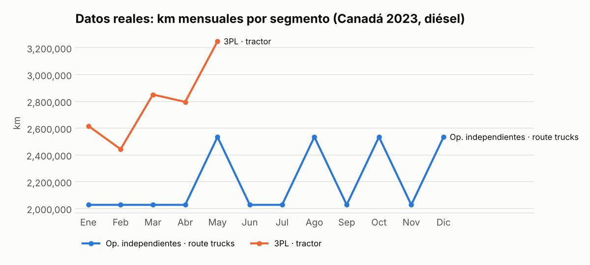
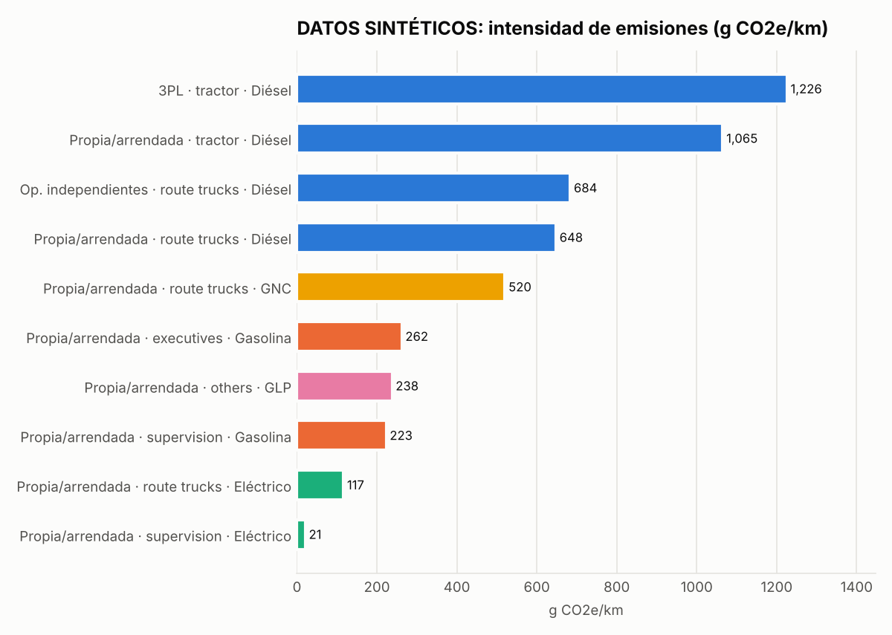

# Fleet Energy Analytics


Pipeline reproducible en Python para **limpiar, validar y analizar** el reporte mensual de consumo
energético de una flotilla (km, litros/kWh y gasto por tipo de vehículo y combustible), estimar
emisiones de CO2e y generar un **reporte HTML autocontenido**.

> **English summary.** A small, tested Python package (`fleet_analytics`) that turns a wide monthly
> fleet-fuel reporting template (Canada, 2023) into tidy data, validates it with explicit rules,
> computes efficiency, cost-per-km, fuel mix and approximate CO2e, and renders a self-contained HTML
> report via a CLI. The real file is sparse (2 of 7 segments, diesel only) and its numbers look
> estimated rather than measured, so the value here is the pipeline; a clearly labeled synthetic
> generator (`--synthetic`) demonstrates full-year, multi-fuel behavior. Tests + ruff run in GitHub Actions.

## El problema

Las áreas de operaciones y sustentabilidad suelen recibir un template de Excel por país con el
consumo de combustible de la flota. Llega en formato ancho, con números como texto (`"$1,721,771.43"`),
muchos huecos y sin controles de calidad. Este proyecto convierte ese archivo en datos limpios y
métricas confiables, y deja explícito **qué se puede concluir y qué no**.

## El dataset

`data/raw/canada_2023_flotilla.csv` (template original `Canada_September (1) (1).csv`):

- 84 filas mensuales (12 meses × 7 segmentos de *propiedad × tipo de vehículo*) + 7 filas `Total`.
- 6 combustibles × 4 métricas: km, litros (kWh en eléctrico), USD y número de vehículos.
- **96 % de las celdas numéricas están vacías.** Sólo hay datos de diésel para
  *Independent Operators · route trucks* (12 meses) y *Logistic Operators (3PL) · tractor* (ene–may).

Detalle completo en [`docs/inspeccion_datos.md`](docs/inspeccion_datos.md).

## Hallazgos (datos reales)

| Segmento | Meses | km | Litros | USD | km/L | USD/km | USD/L |
|---|---|---|---|---|---|---|---|
| Op. independientes · route trucks | 12 | 26.36 M | 6.59 M | 8.70 M | 4.00 | 0.330 | 1.32 |
| 3PL · tractor | 5 | 13.96 M | 6.28 M | 7.95 M | 2.22 | 0.570 | 1.27 |

1. **Las cifras parecen estimadas, no medidas.** El rendimiento es idéntico todos los meses
   (4.0000 km/L y 2.2222 km/L) y el precio de route trucks también (1.3195 USD/L). Los km de route
   trucks sólo toman dos valores, 2,028,000 o 2,535,000 (relación exacta 5/4), consistente con un
   estimado semanal × 4 o × 5 semanas.
2. **Los totales concilian.** La suma de los meses coincide con las filas `Total` del archivo (salvo $3.50 de redondeo en USD de route trucks, dentro de la tolerancia); no hay
   negativos ni registros incompletos.
3. **3PL:** el costo por km (~0.57 USD) es ~1.7× el de route trucks, explicado por el factor de
   rendimiento supuesto (tractocamión vs camión de reparto). El precio pagado por litro baja de
   1.46 a 1.14 USD/L entre enero y mayo; con 5 meses y litros derivados, hay que confirmarlo con facturas.
4. **CO2e estimado ≈ 34,500 t** (2.68 kg/L de diésel). Es un piso: faltan 7 meses del 3PL y toda la flota propia.



**Conclusión honesta:** con este archivo no se puede evaluar la eficiencia real de la flota. El valor
del proyecto es la herramienta: cuando el template llegue completo, el mismo comando produce el
análisis completo y la validación marca los problemas automáticamente.

## Datos sintéticos (claramente etiquetados)

`python -m fleet_analytics report --synthetic` genera un año ficticio con los 7 segmentos y 5
combustibles (diésel, gasolina, GNC, GLP, eléctrico) para mostrar el reporte completo. Cada fila lleva
`source = "synthetic"`, el reporte muestra un aviso visible y el título dice **DATOS SINTÉTICOS**.
Nunca se mezclan con los datos reales.



## Métricas

| Métrica | Definición |
|---|---|
| Rendimiento | km / volumen (km/L; km/kWh en eléctrico) |
| L/100 km | 100 × litros / km (sólo combustibles líquidos) |
| Costo por km | USD / km |
| Costo unitario | USD / litro o USD / kWh |
| km por vehículo | km / vehículos reportados |
| Participación | % de cada combustible en el gasto, km o CO2e (no en volumen: litros y kWh no se suman) |
| CO2e | volumen × factor de emisión |
| Intensidad | g CO2e / km |

Al agregar (por segmento o por mes) se **suman las magnitudes y se recalculan las razones**; nunca se
promedian razones. El número de vehículos se toma como máximo (es un inventario, no un flujo).

### Factores de emisión (aproximados)

| Combustible | kg CO2e / unidad | Fuente |
|---|---|---|
| Gasolina | 2.31 / L | ECCC *National Inventory Report* (~2.307); US EPA *GHG Emission Factors Hub* (~2.32) |
| Diésel | 2.68 / L | ECCC NIR (~2.681); US EPA (~2.70) |
| GLP (propano) | 1.51 / L | ECCC NIR (~1.515); US EPA (~1.50) |
| GNC | 1.73 / L equiv. gasolina | ~1.9 kg/m³ (ECCC NIR); **supuesto**: el template reporta litros equivalentes de gasolina |
| Etanol | 0 (fósil) | Combustión biogénica; se reporta aparte según GHG Protocol |
| Electricidad | 0.12 / kWh | Orden de magnitud del promedio de la red canadiense; varía mucho por provincia |

Son **aproximaciones** para una estimación de orden de magnitud, no un inventario oficial de GEI
(no incluyen CH4/N2O por tecnología ni factores provinciales). Están en `fleet_analytics/emissions.py`.

## Reglas de validación

| Regla | Severidad | Qué revisa |
|---|---|---|
| R1 | error | Valores negativos |
| R2 | error | Registro incompleto (km sin volumen, volumen sin km, costo sin volumen) |
| R3 | warning | Rendimiento fuera del rango plausible del combustible |
| R4 | warning | Costo por litro/kWh fuera de rango |
| R5 | warning | km por vehículo al mes fuera de [100, 25,000] |
| R6 | info | Rendimiento o precio idéntico en ≥3 meses (probable valor derivado) |
| R7 | info | `Quantity` general vacío aunque el combustible reporta vehículos |
| R8 | warning | La suma mensual no concilia con la fila `Total` |
| R9 | info | Segmentos sin datos o con meses faltantes |

Archivo real: 0 errores, 0 warnings, 14 info.

## Cómo correrlo

```bash
python -m venv .venv && source .venv/bin/activate
pip install -r requirements-dev.txt

# Reporte con los datos reales -> reports/reporte_canada_2023_flotilla.html
python -m fleet_analytics report data/raw/canada_2023_flotilla.csv

# Reporte de demostración con datos SINTÉTICOS -> reports/reporte_sintetico.html
python -m fleet_analytics report --synthetic

# Sólo validación (exit code 1 si hay errores)
python -m fleet_analytics validate data/raw/canada_2023_flotilla.csv

# Regenerar notebook ejecutado y gráficas del README
python scripts/build_notebook.py
python scripts/make_readme_charts.py
```

El comando `report` también escribe el formato largo y los hallazgos de validación en `data/processed/`.
El HTML es autocontenido (gráficas SVG embebidas): se abre en cualquier navegador sin conexión.

## Estructura

```
fleet_analytics/        paquete
  cleaning.py           lectura, parseo de números, formato ancho -> largo
  validation.py         reglas R1-R9
  metrics.py            rendimiento, costos, participación, tendencias, CO2e
  emissions.py          factores de emisión con fuentes
  synthetic.py          generador de datos sintéticos
  charts.py             gráficas matplotlib
  report.py             reporte HTML
  __main__.py           CLI
data/raw/               CSV original (sin modificar)
data/processed/         salidas tidy y validación
reports/                reportes HTML generados
notebooks/              analisis_exploratorio.ipynb (con outputs)
docs/                   inspección de datos y gráficas
scripts/                regeneración del notebook y de las PNG
tests/                  pytest
```

## Pruebas y calidad

```bash
pytest -q                          # 42 pruebas
ruff check . && ruff format --check .
```

GitHub Actions corre ruff, pytest y ambos reportes en Python 3.10 y 3.12.

## Próximos pasos

- Completar el template con datos medidos (odómetro, tarjetas de combustible, facturas) y las 5 filas de flota propia.
- Agregar más países y una dimensión `country` en el reporte comparativo.
- Factores de emisión por provincia y año (electricidad) e incluir CH4/N2O.
- Lectura directa del Excel original (`.xlsx`) y validación de esquema con `pandera`.
- Publicar el reporte en GitHub Pages desde CI.

## Licencia

MIT, ver [LICENSE](LICENSE).
